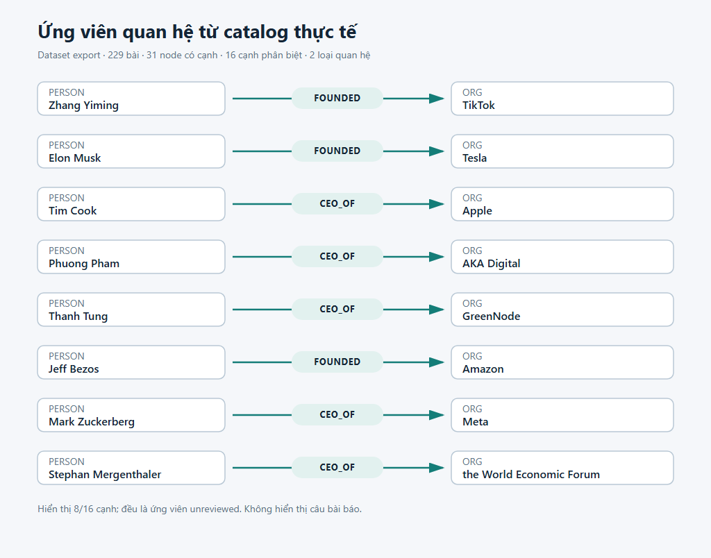
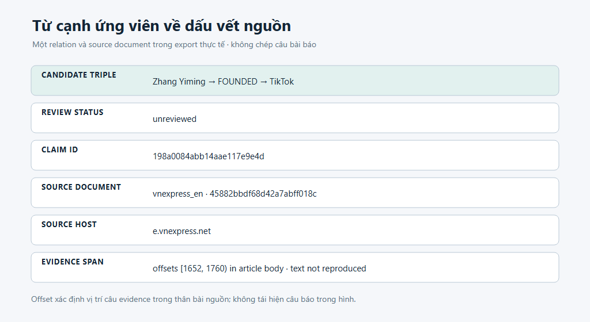
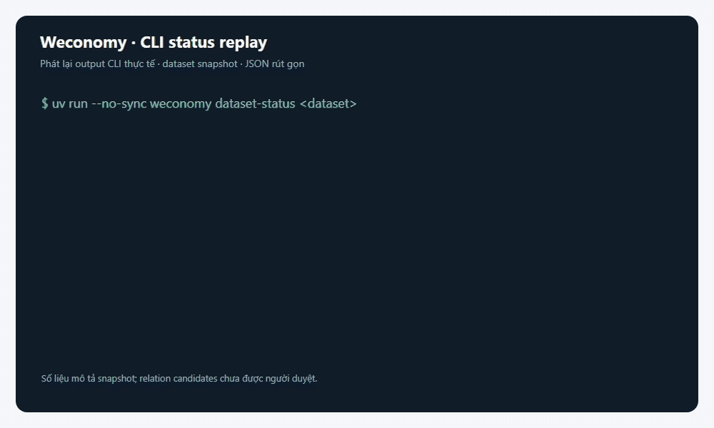

# Weconomy

Pipeline nghiên cứu mã nguồn mở chạy local, tạo **đồ thị tri thức ứng viên** từ tin kinh doanh tiếng Việt và tiếng Anh về tập đoàn đa quốc gia, tỷ phú và quỹ đầu tư quốc tế. Phạm vi đề tài kết nối lãnh đạo công nghệ/tài chính, startup, quỹ đầu tư mạo hiểm và chính phủ qua đầu tư, M&A, kiện chống độc quyền, hợp tác hoặc đứt gãy chuỗi cung ứng. Mỗi quan hệ giữ dấu vết về câu, bài và nguồn để người nghiên cứu kiểm tra.

**Cập nhật 05/11/2026:** discovery hiện dùng Katana; đường RSS, `feedparser` và pilot `news_collector` đã được gỡ. NLP `--ner models` dùng GLiNER-Relex chung interface với checkpoint EN/VI riêng. Lệnh `collect` tự crawl và nạp vào catalog mặc định; `collect-dataset` vẫn nhận URL/run rõ ràng. Bộ kiểm tra hiện có **224 test pass** và Ruff qua. Dataset v4 bên dưới là snapshot lịch sử ngày 04/11; lượt crawl 05/11 ban đầu có 0 relation, còn phát lại 275 câu bằng code mới tìm được 2 cạnh REQUESTS. Các kết quả này chưa phải phép đo precision độc lập.

| Chỉ số | Mục tiêu | Đã ghi nhận ở v4 |
|---|---:|---:|
| Bài được nhận | Tùy chọn | 229 |
| Node có cạnh | 2.000 | 31 |
| Cạnh phân biệt | 5.000 | 16 |
| Loại quan hệ quan sát được | 10 | 2 |
| Precision | Trên 90% | Chưa đo độc lập |

Mục tiêu số lượng graph **chưa đạt**. So với bản cũ, bản sửa khôi phục một bài lỗi NER, loại ba claims gán sai vai trò người sáng lập và khôi phục hai claims CEO có bằng chứng. Kết quả còn 17 claims hỗ trợ 16 cạnh phân biệt; đây là ứng viên máy trích xuất, chưa được nghiệm thu precision. Dữ liệu cũ được giữ ở dataset riêng. Corpus hiện tại còn hạn chế về phân loại thực thể Việt và độ đa dạng quan hệ; tăng ngân sách URL không bảo đảm đạt các ngưỡng.

Lượt test crawl Katana trên trang VnExpress quốc tế (05/11/2026) lấy 100 URL, xử lý 10 bài trong safety cap, và dừng khi đạt 100 entity rows (đếm thực tế 219). Nhưng số relation bằng 0, vì vậy graph nodes/edges bằng 0; NER có nhiều nhãn sai loại. Đây là xác nhận luồng crawl/body extraction, không phải đạt mục tiêu graph hay precision. Crawl config hiện đặt objectives theo graph (2.000 node, 5.000 cạnh và 11 loại quan hệ (>10)); safety cap hiện tại là 500 URL. Xem chi tiết ở phần [crawl danh mục](#crawl-danh-mục-bằng-katana).



*Ảnh xem trước 8 trong 16 cạnh của export v4 thực tế tại `data/experiments/collection-20261104/v4-export`. Corpus có 229 bài được nhận, 31 node có cạnh và 2 loại quan hệ. Các cạnh đều là ứng viên tự động, trạng thái `unreviewed`; hình chỉ hiện tên thực thể và predicate, không sao chép câu bài báo.*



*Một claim trong export v4 được lần ngược về hostname nguồn, document ID và offset evidence trong thân bài; văn bản bài báo không được chép vào ảnh.*



*GIF phát lại rút gọn output JSON của `dataset-status` trên dataset v4, cùng số liệu với snapshot phía trên. Đây là minh họa CLI, không phải bản ghi màn hình giao diện.*

## Cài đặt trên Windows

Cần Python 3.11–3.13, `uv` và kết nối mạng lần đầu cài package/tải model. Backend `--ner models` dùng GLiNER-Relex chung API: `knowledgator/gliner-relex-base-v1.0` cho tiếng Anh và `barb-2-ie-vi` cho tiếng Việt. Model được tải tự động vào Hugging Face cache khi chạy lần đầu; tổng weights cần vài GB. Quan hệ business tiếng Việt được gọi bằng nhãn zero-shot tùy biến; benchmark 62,14 F1 trên model card Barb dùng nhãn khác nên không đại diện cho chất lượng cấu hình này. Backend `gazetteer` không tải model.

```powershell
cd D:\Project\weconomy
uv sync --locked --extra nlp --extra dev
uv run --no-sync weconomy sources
```

Lệnh `sources` liệt kê nguồn theo policy hiện tại. `sources --check` kiểm tra policy và robots.txt ở host gốc; lệnh này không khám phá/tải bài và không xác minh quyền tái sử dụng nội dung.

## Crawl danh mục bằng Katana

Tool crawl mới đọc danh mục từ `config/collection.yaml`, dùng Katana qua Docker để tìm endpoint, rồi chỉ giữ URL bài được liên kết bên trong card bài của đúng target. Link menu và link tới danh mục khác bị loại trước khi tải bài; host, robots.txt và regex URL vẫn được kiểm tra. Collector nhận diện trang sau từ dấu hiệu trong DOM như `rel`, nhãn, class hoặc `alt` (“next”, “trang sau”), không dựa vào cấu trúc URL phân trang riêng từng báo. Nó theo trang tuần tự đến `crawl.max_pages_per_target`; log hiển thị số bài mới và tổng bài theo từng trang. Nội dung bài được trích theo selector riêng từng nguồn. Trên Windows cần Docker Desktop đang chạy và image Katana tải được. Dùng:

```powershell
uv run --no-sync weconomy crawl --config config/collection.yaml
uv run --no-sync weconomy crawl --config config/collection.yaml --target techcrunch_venture
```

Katana là công cụ discovery hiện tại; không còn RSS discovery. YAML quy định target, objective và các safety cap như `max_articles`, `max_documents`, page cap và timebox. URL trang sau phải cùng host, được kiểm tra qua policy/robots và chống lặp. `nodes` đếm entity endpoints có relation; `entities` đếm entity rows. Crawl chạy theo batch và dừng khi đạt objectives hoặc hết giới hạn. Entity rows không đồng nghĩa node/cạnh có ý nghĩa hay precision; NER tiếng Việt hiện cần rà soát và đánh giá độc lập.

## Thu thập dataset có thể tiếp tục

Lệnh thường dùng là `collect`: nó chạy Katana, lấy run vừa tạo và nạp vào catalog mặc định `data/datasets/international-business-katana`. Catalog cũ `data/datasets/international-business` được giữ nguyên vì dùng pipeline trước. Truyền `--dataset PATH` chỉ khi muốn lưu sang chỗ khác.

```powershell
uv run --no-sync weconomy collect
```

Trong lúc chạy, terminal ghim tiến độ hiện tại ở dòng cuối, hiển thị URL/giai đoạn, phần trăm batch và heartbeat mỗi 10 giây ở bước lâu. Lỗi được tô đỏ và ghi nguyên nhân; log đi ra `stderr`, JSON tổng kết vẫn ở `stdout`.

Mục tiêu mặc định là 2.000 node, 5.000 cạnh và 11 loại quan hệ (>10). Safety cap crawl hiện là 500 URL; mỗi target tối đa 100 bài và 100 trang danh mục. Mục tiêu vẫn có thể chưa đạt nếu danh mục không cung cấp đủ bài hoặc extractor không tìm được quan hệ. Tiếp tục cùng catalog bằng `--resume`:

```powershell
uv run --no-sync weconomy collect --resume
```

Khi dataset đã tồn tại, `--resume` tiếp tục catalog đó và kiểm tra fingerprint trước khi crawl. `--force` tạo một catalog mới với hậu tố thời gian/ID duy nhất bên cạnh đường dẫn đã chọn; nó không xóa hay ghi đè dataset cũ. Nếu một batch gặp lỗi, collector ghi lỗi, tiếp tục batch khác và đưa URL lỗi vào hàng đợi khi chạy lại với `--resume`.

Xem trạng thái và xuất các bảng đã commit thành JSONL:

```powershell
uv run --no-sync weconomy dataset-status
uv run --no-sync weconomy export-dataset
```

Export gồm `articles.jsonl`, `entities.jsonl`, `relations.jsonl`, `claims.jsonl` và manifest. Nếu thư mục export đã tồn tại, CLI tạo thư mục tên duy nhất và giữ bản cũ. Mã thoát `0` nghĩa là hoàn tất hoặc đã đạt mọi ngưỡng được yêu cầu; `2` nghĩa là kết thúc lượt nhưng ngưỡng chưa đạt; `1` báo lỗi. Đọc `counts`, `remaining`, `errors` và `targets_met` trước khi sử dụng kết quả.

`dataset-status` và `export-dataset` cũng mặc định dùng catalog nói trên. Export mặc định ở `data/exports/international-business-katana`; dùng `--output PATH` nếu muốn lưu nơi khác hoặc tạo export mới.

GNU Make là tiện ích tùy chọn; `make collect` chạy cùng luồng crawl → dataset:

```powershell
make collect
make collect RESUME=1
make dataset-status
make export-dataset
```

Có thể đổi đường dẫn bằng `DATASET=...` và `OUTPUT=...`. Xem [toàn bộ tham số và cách đếm](docs/collection.md).

## Cách dữ liệu đi qua pipeline

| Lớp | Nội dung | Vai trò |
|---|---|---|
| Bronze | HTML nhận được, URL, checksum, publisher và thông tin truy xuất | Dấu vết nguồn; không phát hành lại nội dung báo chí |
| Silver | Bài đã chuẩn hóa, câu và mention có offset | Chỉ nội dung qua cổng kiểm tra thân bài mới đủ điều kiện NLP mặc định |
| Gold | Entity, claim, event và relation kèm predicate, evidence và provenance | Đầu ra trích xuất tự động; quan hệ vẫn cần người rà soát |
| Catalog | SQLite theo dõi queue, quyết định nhận và các batch Parquet bất biến | Cho phép tiếp tục bằng `--resume`, xem status và export JSONL |

Schema và ý nghĩa các trường nằm trong [SCHEMA.md](docs/SCHEMA.md), quy trình thân bài trong [FULLTEXT.md](docs/FULLTEXT.md), và kiến trúc trong [ARCHITECTURE.md](docs/ARCHITECTURE.md). `import-neo4j` nhận immutable run Parquet hoặc thư mục export JSONL của dataset; `hf-push` chỉ nhận immutable run Parquet. Hugging Face Bucket có thể đồng bộ thư mục `data` theo hướng dẫn tại [HUGGINGFACE.md](docs/HUGGINGFACE.md).

Để tạo bản graph chỉ gồm entity đã được gán subtype theo `initial.md`, dùng `weconomy filter-domain`; lệnh chi tiết và cách đọc bằng chứng nằm trong [docs/commands.md](docs/commands.md). Bản export gốc không bị thay đổi.

Để phân tích lại các run cũ, crawl bổ sung nếu graph sau lọc domain còn thiếu, rồi import Neo4j/AuraDB khi đạt chỉ tiêu, chạy một lệnh:

```powershell
uv run --no-sync weconomy graph-cycle `
  --dataset data/datasets/international-business-gliner-coref-v3 `
  --nodes 2000 --relations 5000 --relation-types 11 `
  --max-candidates 10000 --batch-size 20
```

Lần đầu mặc định phát lại các run đã commit trong `data/datasets/international-business-gliner-v1`; có thể đổi nguồn bằng `--source-dataset`. Các lượt sau tiếp tục dataset đích và chỉ crawl thêm khi graph đã lọc chưa đạt. Nếu thiếu chỉ tiêu, export được giữ lại, lệnh trả mã `2`, và không import graph. Cấu hình Neo4j/AuraDB được đọc từ biến môi trường hoặc `.env`.

## Xử lý lại HTML đã lưu

`collect-dataset --from-run` trích xuất và chạy NLP lại từ bronze của một run đã lưu, theo từng batch. Lặp cờ này để ghép nhiều run; bản chụp được kiểm tra checksum và policy nguồn hiện tại trước khi xử lý. Đầu ra giữ dấu vết về run, document và checksum gốc. Ví dụ trên dùng đường dẫn run của bạn thay cho `RUN_ID`.

```powershell
uv run --no-sync weconomy collect-dataset `
  --from-run data/runs/RUN_ID --batch-size 20 --max-candidates 1000 --ner models
```

Có thể bổ sung run khác vào cùng dataset bằng `--resume` khi cấu hình xử lý tương thích. Khi đổi NER/rule, tạo dataset mới để giữ kết quả cũ và đo trước–sau. Xem [hướng dẫn crawl/replay và ngân sách](docs/collection.md).

## Policy nguồn và giới hạn

Nguồn được chọn từ `config/sources.yaml`; policy có thể thay đổi. Collector tôn trọng allowlist, robots, giới hạn tốc độ/kích thước và redirect; không vượt paywall hay cơ chế chống bot. Hãy kiểm tra policy và target trước khi chạy.

Quyền truy cập trang không cấp quyền tái phân phối toàn văn. Dữ liệu báo được giữ local và không đưa snapshot báo thương mại vào Git. `body_checked` chỉ xác nhận nội dung có trong HTML đã nhận; nó không chứng minh đã lấy được phần ẩn, phân trang hay sau paywall. Bộ lọc chủ đề là heuristic, không phải phép đo độ chính xác.

Các fixture trong `samples/` là trích đoạn có ghi nhận giấy phép, dùng kiểm tra extraction/NLP offline; chúng không đại diện cho tin tức hiện hành hay corpus thu thập đầy đủ. Không dùng chúng thay kết quả thu thập thực.

## Lệnh khác

```powershell
uv run --no-sync weconomy schema
uv run --no-sync weconomy sources --check
uv run --no-sync pytest -q tests
uv run --no-sync ruff check src/weconomy tests
```

Ví dụ run immutable, reprocess, gán nhãn, Neo4j và Docker nằm trong [các lệnh bổ sung](docs/commands.md); trạng thái triển khai và mục lục tài liệu ở [docs/README.md](docs/README.md). Quy trình Hugging Face nằm trong [HUGGINGFACE.md](docs/HUGGINGFACE.md).

## Tài liệu

- [Trạng thái, bằng chứng và việc chưa nghiệm thu](docs/STATUS.md)
- [Thu thập dataset, resume và giới hạn ngân sách](docs/collection.md)
- [Toàn văn và cách ly nội dung](docs/FULLTEXT.md)
- [Schema, predicate và provenance](docs/SCHEMA.md)
- [Gán nhãn và đánh giá](docs/ANNOTATION.md)
- [Lộ trình](docs/ROADMAP.md)

Ảnh PNG và GIF có thể tạo lại từ JSONL export và output JSON của `dataset-status` bằng `scripts/render_readme_media.py`. Trên Windows, lưu trạng thái rồi chạy renderer như sau; Pillow chỉ được nạp trong một môi trường tạm, không đổi `pyproject.toml` hay `uv.lock`:

```powershell
$dataset = "data/datasets/international-business"
uv run --no-sync weconomy dataset-status $dataset | Set-Content -Encoding utf8 "$dataset/status.json"
uv run --no-project --with pillow python scripts/render_readme_media.py `
  --export-dir data/exports/international-business `
  --status-json "$dataset/status.json" --output-dir docs/assets --max-edges 8
```

Microsoft Edge được dùng để render SVG; Pillow tạo GIF với 700 ms giữa các bước, dừng 2,5 giây ở trạng thái cuối rồi lặp lại. Ảnh graph mặc định vẽ tối đa 8 cạnh thật, còn header giữ tổng số từ catalog; renderer kiểm tra counts giữa JSON status và export trước khi ghi ảnh.
