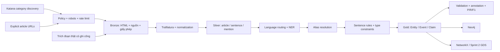

# Kiến trúc và các quyết định Sprint 1

## Luồng dữ liệu

Đơn vị dữ liệu trung tâm là **claim có câu bằng chứng**, không phải cặp tên cùng xuất hiện.
Một sự kiện có thể có nhiều claims từ nhiều câu. Machine candidates chưa đồng nghĩa với sự thật đã duyệt.
Neo4j có Entity, Event, Claim, Sentence, Document. Phép chiếu analytics chỉ dùng Entity và cạnh nghiệp vụ,
không tính các nút provenance vào chỉ tiêu 2.000 thực thể.

## Những quyết định đã thực thi

| Quyết định | Lý do | Giới hạn cần theo dõi |
|---|---|---|
| Python 3.11 + uv.lock | Wheels NLP trên Windows, môi trường tái lập | Model spaCy và Stanza tiếng Việt tải riêng sau `uv sync`; chạy lệnh ứng dụng với `--no-sync` để giữ model spaCy ngoài lock |
| Katana khám phá danh mục | Dùng target URL, giới hạn scope/page/time và policy hiện tại | Phụ thuộc cấu trúc trang danh mục và các cap hữu hạn |
| Registry adapter theo host | Cùng extractor, mỗi nguồn có policy/language/body selector riêng | Chưa thử parser toàn trang từng báo thương mại |
| Trafilatura | Tái sử dụng extractor có sẵn thay viết parser từng báo | Chưa kiểm tra chất lượng full-page thực tế do 403 |
| Gazetteer mặc định, models tùy chọn | Chạy offline nhẹ ngay; models dùng spaCy/Underthesea cho NER và dependency parser tiếng Anh/Việt | Parser Việt là Stanza, khởi tạo lazy; cần tải model Việt riêng; từ điển predicate còn hẹp |
| Alias xác định, fuzzy chỉ đề xuất | Tránh gộp nhầm doanh nghiệp/người trùng tên | Exact-surface chưa giải quyết đồng danh/đa ngôn ngữ đầy đủ |
| 11 predicate với type constraints | Schema chung cho cả Sprint 1 và 2; tách acquisition agreement khỏi completed acquisition | Mẫu trực tiếp có recall thấp; số predicate định nghĩa khác số loại quan sát thật |
| Parquet + immutable run | Debug/reprocess có thể truy vết và không ghi đè | Chưa catalog/version table nhiều người ghi |
| Event identity bảo thủ | Tránh gộp những vòng đầu tư khác nhau | Chưa dedup sự kiện xuyên bài/run khi không có ngày sự kiện |
| Neo4j Community | Lưu graph có truy vấn provenance, chạy local | Chưa nghiệm thu live khi Engine không hoạt động |
| NetworkX trước GDS | Không phụ thuộc plugin server để phân tích pilot | Thuật toán toàn cặp chưa tối ưu cho graph lớn |

## Contracts giữa module

- `access.py` là cổng cho mọi request tải bằng Python. Katana chỉ khám phá URL; URL tải bài vẫn qua policy, robots và rate limit trong pipeline.
  Chuyển hướng phải qua policy lại. robots không tải được thì dừng, không tự suy ra cho phép.
- Manifest offline là đầu vào do người dùng quản lý, phải có giấy phép/ghi công/source/kind/thời điểm;
  không dùng nó để hợp thức hóa tập dữ liệu không có quyền. Snapshot có SHA thì kiểm tra SHA.
- Offset là index ký tự Unicode Python trong **văn bản silver đã normalize**, không phải byte HTML.
  NER giữ surface gốc; tên canonical không thay văn bản bằng chứng.
- `nlp.py` nhận một câu và language. `unknown` không tự route sang tiếng Anh.
- `schema.py` giữ kiểu Arrow và danh sách predicate. Thêm predicate cần cập nhật pattern,
  ràng buộc kiểu, nhãn, test và query; không thêm tùy tiện để đủ chỉ tiêu.
- `pipeline.py` tạo run mới. URL hash + raw checksum xác định revision tài liệu; sentence ID gắn revision
  và offset; entity ID gắn canonical name + type. Hàm `stable_id` dùng JSON để tránh nhập nhằng nối chuỗi.
- Import Neo4j chỉ nhận dữ liệu qua validate. Tham số hóa toàn bộ giá trị; tên loại cạnh từ whitelist.
  Tạo constraint trước, transaction dữ liệu sau. Không tự xóa dữ liệu đã tồn tại.

## Đường mở rộng sau pilot

1. Thu thập đủ quyền từ nguồn thật, đo extraction theo nguồn/ngôn ngữ; giữ metadata xuất bản và snapshot.
2. Thêm tập nhãn theo article/event/time split; bổ sung alias đã duyệt, định danh ngoài (Wikidata/LEI)
   khi có bằng chứng đồng nhất. Chỉ fuzzy/embedding không đủ kết luận cùng thực thể.
3. Backend models dùng dependency RE tiếng Anh và Stanza tiếng Việt cho một nhóm predicate đã ánh xạ.
   Kiểm định cả hai trên nhãn độc lập. Tách reported/planned/
   denied/rumoured, vai trò chủ thể/đối tượng, thời gian quan hệ và attribution. Không nâng số cạnh bằng co-occurrence.
4. Khi batch tăng, thay pairwise shingles hiện O(n²) bằng MinHash/LSH; index xuyên run, partition Parquet
   theo source/date/language. Không cần Kafka để đạt vài nghìn thực thể; SQLite job ledger + batch là bước kế.
5. Chuẩn hóa event identity bằng actor+predicate+transaction/date/value với human review cho trường hợp mơ hồ.
   Không dùng publication date thay event date; không gộp chỉ dựa vào một cặp actor.
6. Khi cần tái dựng graph nhiều lần, thêm dataset version/materialization và kiểm tra count trong Neo4j;
   không coi mọi revision là sự kiện mới thật. Gold xuất bản cần quy trình accept/reject và lịch sử duyệt.

Giới hạn hiện tại: đơn tiến trình, chưa checkpoint từng request, không retry tự động 403/429,
chưa pin DNS đến socket (chỉ dùng registry đáng tin, không mở crawler nhận URL Internet tùy ý),
chưa coreference, chưa event-time extraction, chưa inference phủ định phức tạp, chưa UI annotation.
